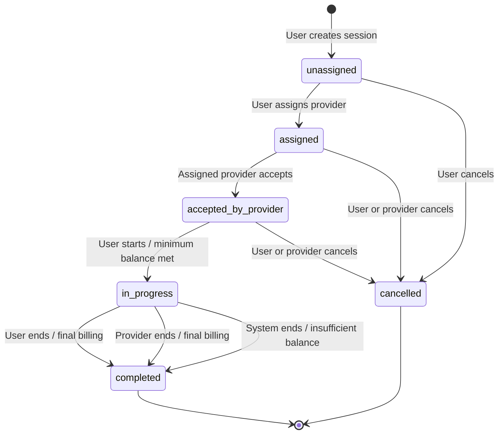

# Session State Diagram

The session lifecycle implemented by the API is shown below. Cancellation is available before the session starts. An active session can be completed by the user, provider, or system.

## Important invariants

- A session can start only after provider acceptance.
- The user must have at least five times the frozen session rate in their wallet to start.
- A user may have no more than one `in_progress` session at a time.
- The session rate is copied from the provider when the provider is assigned.
- Invalid transitions return HTTP 400 with a meaningful error.
- If the wallet cannot cover the next full minute, the session is completed with `ended_by = system` and `end_reason = Insufficient Balance`.
